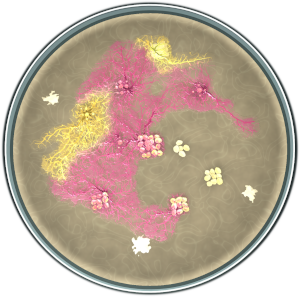
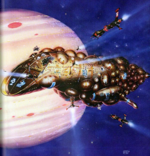

Well... I guess I'm not going to start blogging again despite the promises made in my previous
almost two-year-old post. I've been busy with work and numerous side projects.

I've been messing around with vibe-coded games. [MYXO](https://eyeree.art/petri/)
([repo](https://github.com/eyeree/petri)) represents a couple of weeks’ worth of occasional prompts.
It fit well within a Claude Code $100/month plan. This is a revival of a Godot game, [Cellular
AutoBata (CAB)](https://eyeree.art/cab/) ([repo](https://github.com/eyeree/cab)), that I abandoned a
while ago. With Claude, I was able to implement the biological-looking visualization in the new
version without diving deep into metaballs and other graphics techniques. I was also able to have
Claude generate more complex genomes and levels, and do hundreds of simulated games to adjust
balance. These are things I could have done without AI, but it would have taken many hundreds of
hours of learning and experimentation, which, as the state of CAB has shown, was unlikely to have
ever happened. But even with the AI's help, I've iterated on the gameplay and visualization many
times, to make it more like what I wanted.

I also vibe coded [WER (world explorer, rust)](https://eyeree.art/wer/)
([repo](https://github.com/eyeree/wer)) as the first step in a large project. Here I had the agents
create some very complex world generation models (multiple interacting ecosystems) that allow
"moving" between infinite worlds as part of the gameplay. The math involved here is way beyond
anything I could pick up easily. So this is another example of AI allowing me to create things that
wouldn't otherwise exist. I plan to pick up this project again at some point.

I've got a number of other game projects going, all with similar "leverage" created by using AI. For
one, I'm setting up an agent-driven 3D content creation pipeline. For another, I'm using AI to
generate "meaningful" derelict alien spaceships (i.e. not just random but with a sense of design or
purpose behind them, just not a "human" design or purpose). What I'm going for here is art inspired
by Cowley's [Spacewreck: Ghostships and Derelicts of
Space](https://archive.org/details/terrantradeauthorityhandbookspacewreck/mode/2up) and [Spacecraft
2000 to 2100 AD](https://archive.org/details/spacecraft2000to0000cowl/page/n5/mode/2up).

That last project is leading into a more general framework for using AI to generate creative content
that is "interesting" rather than just being "random". Random procedural generation, even when it
looks natural on the surface, typically lacks the "depth" needed for it to really "make sense". In
nature, it's the forces of evolution that drive the underlying structures. Ecosystems are a web;
nothing exists alone. For alien spaceships, it's different "forces" that drive the design but it's
the same core idea. The ship can't just be random; it has to "make sense" even if the overall effect
is alien.

More to come on that in the future. My point now is how the use of AI has unblocked progress on
these projects. Whether it is the time saved or the ability to apply algorithms beyond what I
immediately understand, the effect is being able to produce experiences that wouldn't otherwise have
existed. 

This capability is empowering, but creates a different problem: an explosion of content. Most of it
will be of low quality (i.e. AI slop), but there will be gems out there to be found. And that brings
me to my other area of work: agent-driven decentralized content discovery protocols. How can I make
an agent explore what is available and discover things that I find personally interesting? And can
this be done without ANY marketplace or curation done by a 3rd party?
